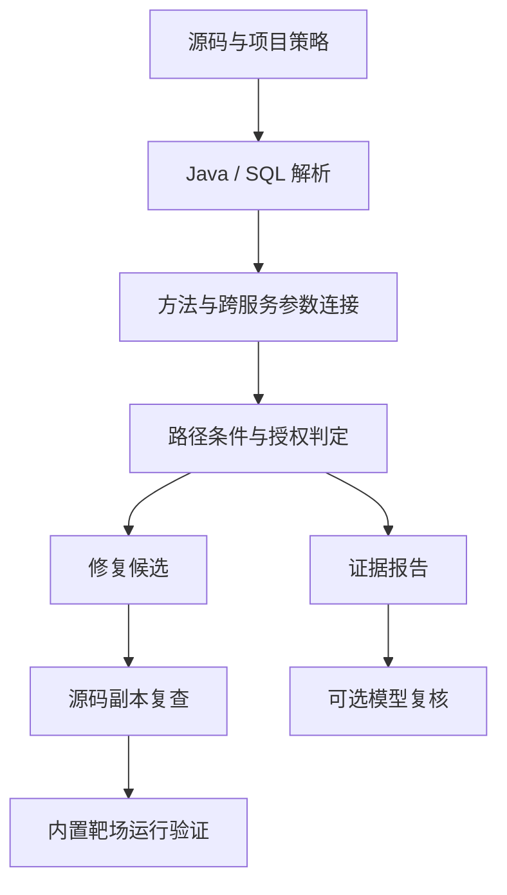

# 设计说明

MicroBind 要回答的是：一次数据操作是否受到针对同一对象、同一主体的有效授权约束。单独发现鉴权方法不够，还需要知道失败路径能否阻止操作，以及被检查的对象是否就是随后读写的对象。

## 分析路径

Java AST 和 SQL AST 提供方法、调用、端点和数据操作。分析器从业务入口开始，在有界路径内传播符号值和成立条件，再把 SQL 对象与授权要求对照。配置负责说明服务边界、可信身份方法及业务策略。

### 对象与身份

每个入口参数拥有独立符号；赋值和实参/形参绑定保留其来源。Feign 按服务名、HTTP 方法和路径形状连接接收端，路径变量按位置、查询参数按线上的名称对应。无法唯一连接时保留缺口。

查询结果以 `row(表, 对象符号)` 表示。读取归属字段得到相应列符号，拒绝分支结束后，后续路径继承已成立的等式。两个参数都来自请求，并不表示它们相等。SQL 约束只提取合取中必然成立的部分，不能用 `tenant_id = ? OR status = 'OPEN'` 证明租户隔离。

写操作在执行位置保存条件快照，后续检查不能追溯保护已发生的写入。读操作携带数据来源，在值返回到业务入口时判断泄露条件，因此支持“先查询、返回前检查”。仅用于权限判断且未输出的数据，不单独计作读取泄露。

### 判定范围

| 状态 | 含义 |
| --- | --- |
| `suspected` | 支持的路径中存在未满足的授权要求 |
| `covered` | 已建模路径满足配置中的要求；仍需结合入口覆盖信息解释 |
| `needs_review` | 语义、调用或数据约束不足，不能作出完整判定 |

报告同时给出入口覆盖信息。`assessment` 区分 `analyzed`、`partial` 和 `no_operation_evidence`，零操作记录不能推导出安全。

当前采用 javalang 与有界符号解释，便于在小型样例上核查参数传播和修复结果。代价是 Java 8 语法限制，以及不完整的类型解析、循环和异常语义。深度与状态数分别受预算约束；未知语法、调用或预算耗尽会进入覆盖缺口。它不是完整 CPG 或 SMT 分析器。

授权策略优先采用显式配置；DDL 可提供带来源标记的归属/租户候选。公开读取、共享资源等业务约定需要人工确认，不能由字段命名直接推出。

## 修复策略

对象参数错配优先调整实际调用参数；身份错误优先改为已配置的可信来源。缺少检查时，仅在对象、主体和已有 guard 均可取得的位置补调用。可信租户已经传到 Mapper 时，可以对适用的静态 SQL 补租户约束。

补丁保存原文件 SHA-256、修改区间、前后文本、原因和受影响入口。应用前校验原文件，输出到新副本，再运行同一分析器。复查只能说明静态结论变化；内置靶场另外验证 HTTP 和数据库效果。复杂路径没有合适模板时保留未修复状态。

采用已有检查和局部修改，主要考虑业务兼容性与可审查性。当前未枚举所有修复位置，也不自动生成新的权限制度。

## 前后端与任务执行

React 负责导入、状态和证据展示，FastAPI 负责鉴权和任务记录。SQLite 使用 WAL，worker 通过短事务领取任务，并在独立子进程中执行。心跳、超时和进程组清理由 worker 管理；失去心跳的运行任务标为失败，不自动重放。

队列状态为 `queued → running → succeeded / failed`，排队任务可取消。任务结果包括分析、补丁、可选复核、运行验证和技能事件。没有执行运行验证时，`verification` 留空。

| 代码位置 | 职责 |
| --- | --- |
| `frontend.py`、`model.py` | Java/SQL 解析、框架适配、符号与证据结构 |
| `engine.py` | 路径传播与授权判定 |
| `repair.py`、`lab.py` | 修复候选、副本应用、内置靶场验证 |
| `report.py` | JSON、Markdown、HTML、SARIF |
| `server/app.py`、`store.py`、`worker.py` | HTTP、持久队列、进程生命周期 |
| `server/pipeline.py`、`workflows/` | 工作目录、技能计划与执行记录 |
| `evidence_tools.py`、`smart.py`、`mcp_server.py` | 证据检索、可选模型循环和 MCP 接口 |
| `frontend/src/` | 工作台及样例、技能页面 |

除健康检查外，API 使用实例共享令牌。主要接口为项目导入/列表、任务创建/状态/结果/下载，以及 `/api/capabilities`、`/api/skills`。API 模式使用同源代理，当前不提供用户级项目隔离。

## 扩展边界

技能层将分析能力与队列、页面分开；技能声明和执行方式见 [技能接口](AGENT_SKILLS_PLAN.md)。模型与 MCP 复用只读证据查询，模型意见不改写静态事实。

优先扩展 Java 框架适配，减少实际样例中无法解释的路径。后续如接入 Joern/CodeQL，应通过同一证据结构比较源码解析与调用恢复结果，再决定替换范围。IDA 适合 JNI 和本地二进制；当前项目未集成其运行环境。
