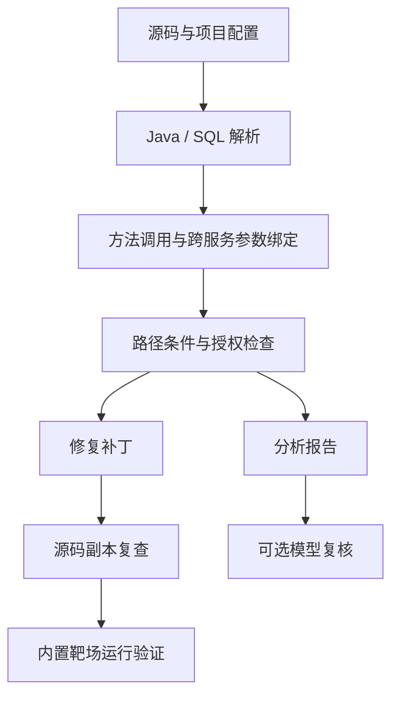

# 设计说明

MicroBind 沿调用链检查用户身份、授权条件和数据操作之间的关系。分析器不仅查找授权方法，还会检查失败分支是否中断执行，以及检查对象与后续读写对象是否一致。

## 分析流程

Java AST 和 SQL AST 用于提取方法、调用、接口和数据操作。分析器从业务入口开始传播参数值和路径条件，再逐项核对配置中的授权要求。服务边界、可信身份方法和业务规则由 `project.yml` 指定。

### 对象与身份

每个入口参数都有独立的符号值，赋值和实参、形参绑定保留其来源。Feign 调用根据服务名、HTTP 方法和路由模式连接到接收端；路径变量按位置匹配，查询参数按请求中的名称匹配。无法确定唯一接收端时，报告会记录未连接的调用。

查询结果表示为 `row(表, 对象符号)`，读取归属字段会得到相应的列符号。授权检查的拒绝分支结束后，后续路径才能使用已成立的等式。两个参数即使都来自请求，也不会被视为相等。SQL 中只提取一定成立的合取条件，例如 `tenant_id = ? OR status = 'OPEN'` 不能证明所有结果都受租户约束。

写操作使用执行当时的条件，写入之后的检查不能保护已经发生的操作。读操作则继续跟踪数据去向，在结果返回业务入口时判断是否泄露，因此支持“先查询、返回前检查”的代码。只用于权限判断、没有对外返回的数据不单独计为读取泄露。

### 结果与支持范围

| 状态 | 含义 |
| --- | --- |
| `suspected` | 当前可分析的路径中，有授权要求未得到满足 |
| `covered` | 当前建模的路径满足配置中的授权要求 |
| `needs_review` | 语法、调用或数据约束尚未完整解析，需要进一步确认 |

报告中的 `assessment` 描述入口分析情况：`analyzed` 表示完成分析，`partial` 表示部分路径未支持，`no_operation_evidence` 表示未识别到可判定的数据操作。没有操作记录时，无法据此判断授权是否完整。

当前使用 javalang 解析 Java 8 语法，通过符号解释跟踪路径。调用深度和路径状态数分别设有上限。类型解析、循环和异常处理仍不完整；遇到不支持的语法、调用或超出上限时，会记录覆盖缺口。

授权规则以显式配置为准。DDL 可以提供带来源说明的归属列、租户列候选，但公开读取、共享资源等业务约定仍需人工确认。

## 修复策略

- 对象参数不一致时，优先调整调用实参。
- 身份来自可控请求时，优先改用配置中的可信身份方法。
- 缺少检查时，在能取得对象和可信身份的位置复用已有授权方法。
- 可信租户已传到 Mapper 时，对适用的静态 SQL 补充租户条件。

每个补丁记录原文件 SHA-256、修改位置、前后代码、修改原因和受影响入口。应用前先校验文件，再修改新的源码副本并重新分析。没有适用模板或无法确定修改位置时，保留未修复状态。

我们优先复用已有检查并控制修改范围，方便审查，也减少对正常业务的影响。静态复查说明分析结果如何变化；内置靶场另行检查 HTTP 响应和数据库状态。

## 前后端与任务执行

React 工作台负责项目导入、任务状态和证据展示，FastAPI 负责接口鉴权和任务记录。SQLite 使用 WAL 模式，worker 通过短事务领取任务，并在独立子进程中执行。worker 管理心跳、超时和子进程清理；心跳过期的运行任务标为失败，不自动重试。

任务状态为 `queued → running → succeeded / failed`，排队中的任务可以取消。结果包含分析报告、补丁、可选模型复核、运行验证和执行步骤记录。未运行靶场验证时，`verification` 为空。

| 代码位置 | 职责 |
| --- | --- |
| `frontend.py`、`model.py` | Java/SQL 解析、框架适配、符号和证据结构 |
| `engine.py` | 路径传播和授权检查 |
| `repair.py`、`lab.py` | 生成补丁、修改副本、靶场验证 |
| `report.py` | 导出 JSON、Markdown、HTML 和 SARIF |
| `server/app.py`、`store.py`、`worker.py` | HTTP 接口、持久队列和任务进程 |
| `server/pipeline.py`、`workflows/` | 工作目录、执行计划和步骤记录 |
| `evidence_tools.py`、`smart.py`、`mcp_server.py` | 证据查询、模型复核和 MCP 接口 |
| `frontend/src/` | 工作台、样例和技能页面 |

除健康检查外，API 都需要实例访问令牌。主要接口包括项目导入与列表、任务创建与状态、结果与下载，以及 `/api/capabilities`、`/api/skills`。前端通过同源代理调用 API，目前不提供用户级项目隔离。

## 扩展方式

分析步骤通过技能注册表与队列、页面连接，CLI 和工作台复用同一分析能力，详见 [技能接口](AGENT_SKILLS_PLAN.md)。模型和 MCP 共用只读证据工具，模型意见单独保存。

后续优先补充 Java 框架适配。如果接入 Joern 或 CodeQL，将先用现有证据结构比较源码解析和调用恢复结果。JNI、本地二进制分析及 IDA 接口列入后续计划，当前版本尚未集成。
